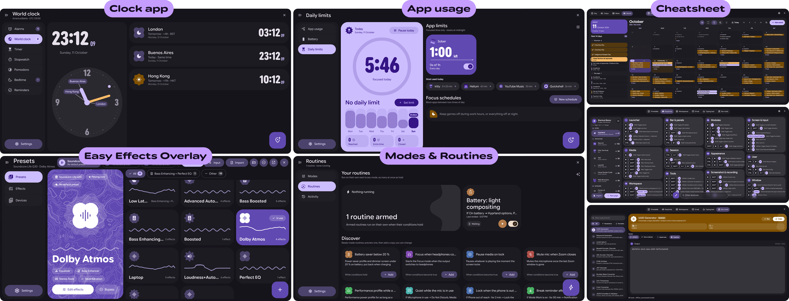
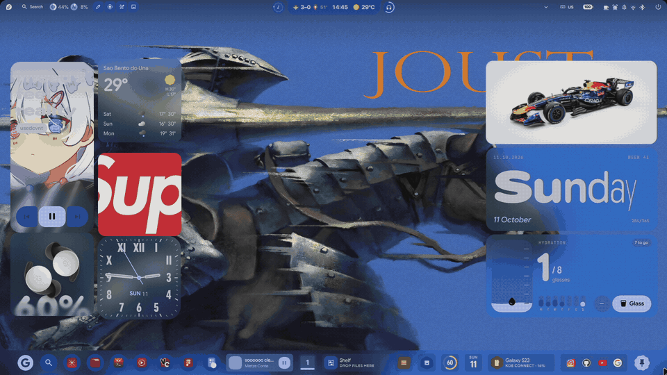
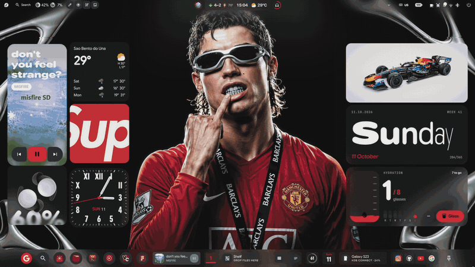
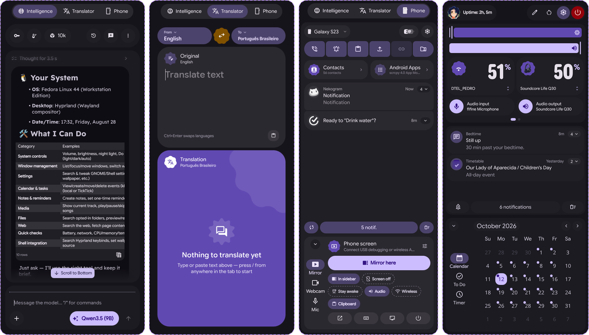
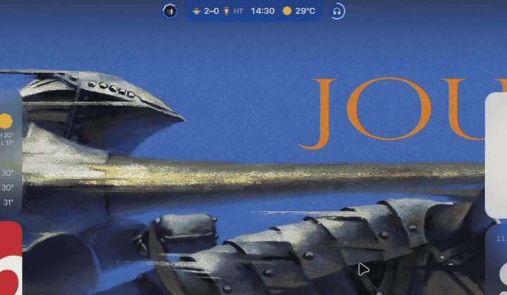
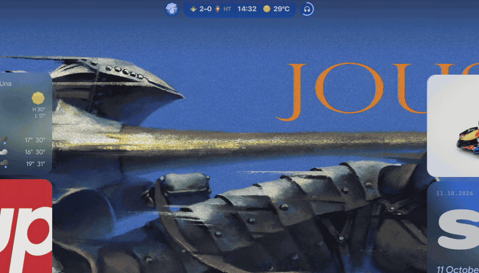
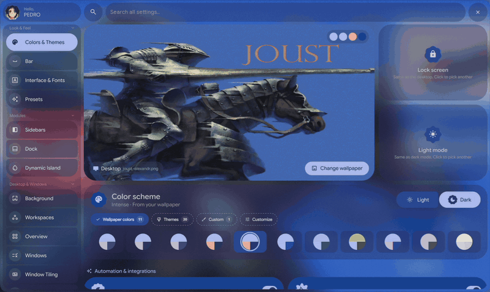
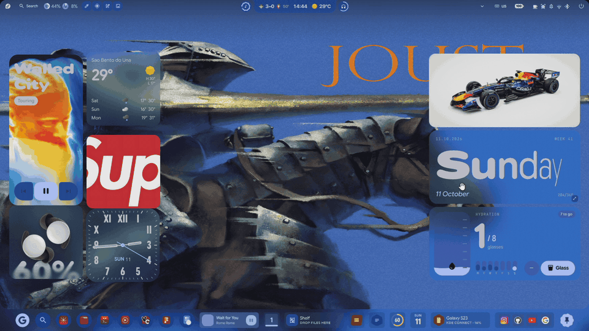

<div align="center">


<br><br>

<picture>
  <source media="(prefers-color-scheme: dark)" srcset="assets/readme/subtitle-dark.png" />
  <source media="(prefers-color-scheme: light)" srcset="assets/readme/subtitle-light.png" />
  
</picture>

<br><br>


https://github.com/user-attachments/assets/9bd6d47c-a6af-4352-8cf0-1819a526230f


</div>

<br>

A heavily customized fork of **[ii-vynx](https://github.com/vaguesyntax/ii-vynx)**, itself built on **[illogical-impulse](https://github.com/end-4/dots-hyprland)**. Every surface follows **Material 3 Expressive**: shapes that morph with state, variable type that carries the hierarchy, and a palette generated from your wallpaper by Matugen. It runs on **[Quickshell](https://quickshell.org/)** and **[Hyprland](https://hypr.land/)**.

> [!WARNING]
> This is my personal setup. It isn't focused on performance or stability, so expect bugs. Report them in an issue or in the ii-p3drovfx thread on the **[end-4 Discord](https://discord.gg/GtdRBXgMwq)**. PRs are welcome.

## Built-in apps

<!-- PLACEHOLDER — bento grid 1 (Figma): Clock, EasyEffects, Modes & Routines, App usage,
     Cheatsheet: Timetable, Keybinds, Typing test, Dev tools.
     Export at 1840 px wide, one dark and one light version:
     assets/readme/bento-apps-dark.png / assets/readme/bento-apps-light.png -->
<picture>
  
</picture>

**Clock** has alarms, world clock, timers, pomodoro and bedtime. **EasyEffects** has presets and effects for every output. **Modes & Routines** runs your automations, and **App usage** tracks screen time and daily limits. The **Cheatsheet** holds a calendar that syncs with Google, Outlook and ICS, an editable keybind library, a typing test and offline developer tools.

## Lock screen & theming

<table>
  <tr>
    <td width="50%"></td>
    <td width="50%"></td>
  </tr>
  <tr>
    <td align="center"><b>Lock screen & Always On Display</b><br><sub>Desktop widgets follow you onto the lock screen. The AOD keeps them on a black screen.</sub></td>
    <td align="center"><b>A palette for every wallpaper</b><br><sub>Matugen schemes or built-in themes, applied across the bar, island, widgets and apps.</sub></td>
  </tr>
</table>

## Requirements

- **Hyprland 0.56.1 or newer**
- **Matugen 4.1.0 or newer**
- **quickshell-git 0.3.0 or newer**

## Installation

### Default installation

Use this if you don't have illogical-impulse installed yet. It sets up the base
dotfiles and everything they need, then puts my config on top.

```bash
git clone --recurse-submodules https://github.com/P3DROVFX/ii-p3drovfx.git
cd ii-p3drovfx
./setup-ii-p3drovfx.sh install
```

### Minimal installation (Quickshell config only)

Use this if illogical-impulse already works and you only want my Quickshell config.
Nothing else is touched, and your current config is moved to a backup instead of deleted.

```bash
git clone --recurse-submodules https://github.com/P3DROVFX/ii-p3drovfx.git
cd ii-p3drovfx
./setup-ii-p3drovfx.sh
```

> [!NOTE]
> Some modules, like the Gmail client, need API keys set up by hand.

## Documentation

The **[ii-p3drovfx wiki](https://github.com/P3DROVFX/ii-p3drovfx/wiki)** describes every component in detail.

<details> <summary><strong>🛠 Common Issues</strong></summary>

<br>

### Dynamic colors / Matugen are not working

If wallpaper colors are not being applied and you see an error such as:

> matugen exited with an error, so the shell kept its previous palette.

First, make sure you are running:

- **Matugen** 4.1.0 or newer
- **quickshell-git** 0.3.0 or newer

You can check the installed versions with:

```bash
matugen --version
quickshell --version
```

#### Arch Linux / CachyOS

Make sure you are using the AUR `quickshell-git` package, rather than another Quickshell build provided by a third-party repository.

A reported case on CachyOS was caused by the system using the Noctalia Quickshell package from the CachyOS repositories instead of `aur/quickshell-git`. Replacing it with the AUR package fixed Matugen and dynamic colors.

```bash
yay -S aur/quickshell-git
```

If another Quickshell package is installed, your package manager may ask to replace the conflicting package.

---

### Quickshell stopped working after a Qt update

Quickshell may stop starting correctly after a Qt update if the installed `quickshell-git` package was compiled against the previous Qt version.

For example, this can happen after updates such as:

```
Qt 6.11.1 -> Qt 6.11.2
```

Rebuild `quickshell-git` against the newly installed Qt libraries:

```bash
yay -S --rebuild aur/quickshell-git
```

Then restart Quickshell.

If rebuilding does not solve the problem, completely reinstall `quickshell-git` using your AUR helper.

> **💡 Tip**
>
> If the shell suddenly stops working immediately after a Qt system update, rebuilding `quickshell-git` should be one of the first troubleshooting steps.

---

### Tray icons disappear after an update or shell restart

Apps such as Discord, Vesktop, Steam or other Electron apps may vanish from the system tray after the shell restarts (for example after an update) and only come back once you restart each app.

This is handled by the `sni_watcher` helper, which keeps the tray alive across shell restarts:

```
~/.config/quickshell/ii/scripts/tray/sni_watcher
```

It ships as source only, so it has to be built once (needs a Rust toolchain):

```bash
~/.config/quickshell/ii/scripts/rust-helpers.sh build sni_watcher
```

Hyprland starts it automatically at login. To start it right away without logging out:

```bash
~/.config/quickshell/ii/scripts/tray/sni_watcher & disown
```

You can check that it is running with `pgrep -x sni_watcher`. Apps whose icon is already gone need to be restarted once; after that, their icons survive shell restarts.

</details>

## Sidebars

<!-- PLACEHOLDER — bento grid 2 (Figma): AI chat, Translator, Phone, sidebar dashboard.
     Export at 1840 px wide, dark and light:
     assets/readme/bento-sidebars-dark.png / assets/readme/bento-sidebars-light.png -->
<picture>
  
</picture>

The left sidebar holds an **AI chat** for cloud and local models, a **Translator** with alternatives and audio, and your **phone**: notifications, files, clipboard and a live screen mirror you can touch. The right sidebar is the **dashboard**, with quick toggles, audio, network and notifications.

## Everyday tools

<table>
  <tr>
    <td width="50%"></td>
    <td width="50%"></td>
  </tr>
  <tr>
    <td align="center"><b>Dynamic Island</b><br><sub>Media, activities and OSDs live in the notch. Hover it to open the dashboard. Press <b>Esc</b> while expanded to collapse directly to the resting time-only face.</sub></td>
    <td align="center"><b>Search</b><br><sub>Apps, math, unit and currency conversion, commands and AI, with no prefixes.</sub></td>
  </tr>
  <tr>
    <td width="50%"></td>
    <td width="50%"></td>
  </tr>
  <tr>
    <td align="center"><b>Settings</b><br><sub>Every page previews the real component as you change it. Configure autohide sensitivity, window overlay vs push mode, and keyboard shortcuts.</sub></td>
    <td align="center"><b>Live Draw</b><br><sub>Annotate anything on screen, spotlight and zoom, then save or copy it.</sub></td>
  </tr>
</table>

## Enhanced Dynamic Island & Autohide Architecture

This fork features a rebuilt top-shell autohide engine and enhanced keyboard interactions:

- **Escape (`Esc`) to Collapse**: Pressing `Escape` while the island or dashboard is expanded collapses it immediately to the contracted resting time-only clock face, suppressing re-expansion until the pointer leaves.
- **Top Shell Autohide Coordination**: A centralized hover bus debounces reveals and retractions, eliminating top-edge jitter and window shaking.
- **Window Overlay Mode**: Toggle `pushWindows` in Settings (`Bar → Behavior`) to let the bar and island overlay smoothly above windows without resizing or pushing desktop tiles.
- **Accurate Top Edge Sensor**: Handover logic ensures that hidden masks never interfere with browser tabs or top window controls.
- **Notification App Icon Sanitization**: Fixes raw file paths sprawling across notification popups.

For full technical specifications and implementation details, see [**CHANGES.md**](../CHANGES.md).

## Credits

- **[end-4](https://github.com/end-4):** Creator of illogical-impulse.
- **[vaguesyntax](https://github.com/vaguesyntax):** Creator of ii-vynx.
- **[pc-trade](https://github.com/pctrade):** Some design and features inspo.
- **[so-do-i-look-like-him](https://github.com/so-do-i-look-like-him):** Installation bug fixes.
- **[asteriau](https://github.com/asteriau):** Cheatsheet keybinds animations.
- **[hnpf](https://github.com/hnpf):** Nothing widgets design.
- **[gowall](https://github.com/Achno/gowall):** Dynamic icons theme system.
- **[hyprmon](https://github.com/erans/hyprmon):** Monitor management in settings.
- **[Quickshell](https://quickshell.org/):** Widget system.
- **[Hyprland](https://hypr.land/):** Compositor.

<br>

<div align="center">
  <b>If you like this project, consider giving it a star! ⭐</b>
</div>
